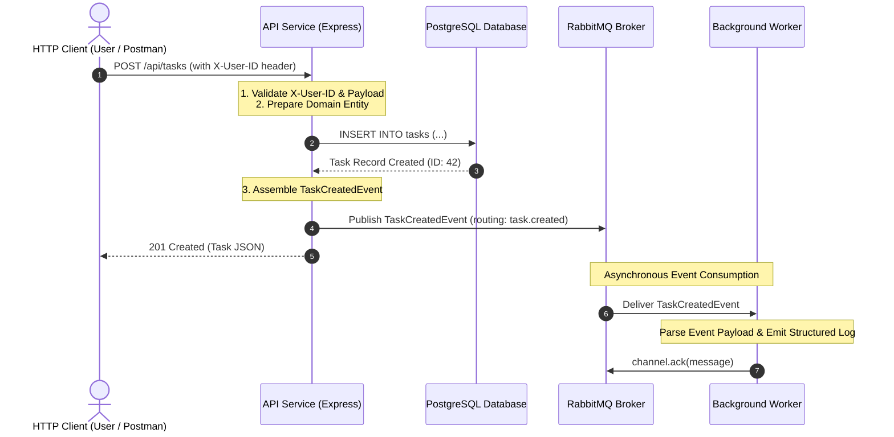
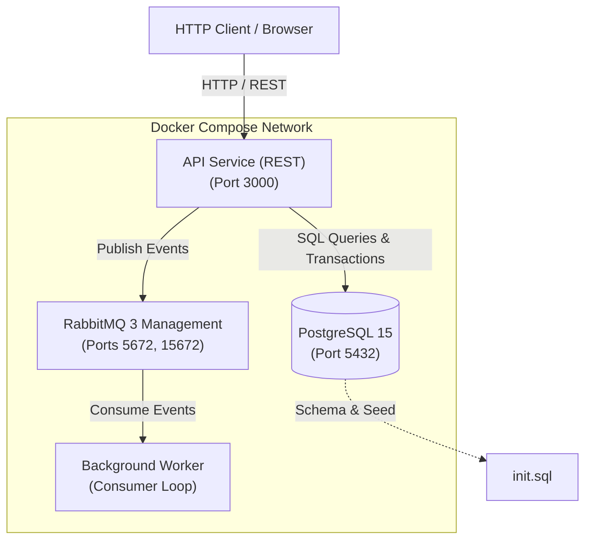

# Event-Driven Task Management System

A production-grade, highly scalable Task Management API designed around **Event-Driven Architecture (EDA)**, the **Repository Pattern**, and container orchestration with **Docker Compose**.

---

## 📑 Table of Contents

- [Architectural Overview](#architectural-overview)
- [System Architecture Diagram](#system-architecture-diagram)
- [Key Design Patterns](#key-design-patterns)
- [Directory Layout](#directory-layout)
- [Prerequisites](#prerequisites)
- [Environment Configuration](#environment-configuration)
- [Docker Compose Orchestration](#docker-compose-orchestration)
  - [Starting the Services](#starting-the-services)
  - [Container Health & Startup Coordination](#container-health--startup-coordination)
  - [Stopping the Stack](#stopping-the-stack)
- [Database Schema & Automatic Seeding](#database-schema--automatic-seeding)
- [API Reference & Documentation](#api-reference--documentation)
  - [Standard Error Response Schema](#standard-error-response-schema)
  - [Authentication via X-User-ID](#authentication-via-x-user-id)
  - [User Endpoints](#user-endpoints)
  - [Task Endpoints](#task-endpoints)
  - [System Health Check](#system-health-check)
- [Event-Driven Integration (RabbitMQ)](#event-driven-integration-rabbitmq)
  - [Event Schemas](#event-schemas)
  - [Background Worker Consumption Loop](#background-worker-consumption-loop)
- [Structured JSON Logging](#structured-json-logging)
- [Automated Testing Strategy](#automated-testing-strategy)
  - [Running Tests](#running-tests)
  - [Test Suite Architecture](#test-suite-architecture)

---

## 🏛️ Architectural Overview

In a traditional monolithic architecture, synchronous operations (such as notifying assigned users, recalculating metrics, and synchronizing search indices) degrade API throughput and increase end-user latency.

This system decouples core CRUD operations from downstream side-effects through an **Event-Driven Architecture**:
1. **API Service (Producer)**: Receives HTTP requests, executes business validation, commits state mutations to PostgreSQL via the Repository layer, immediately publishes an event to RabbitMQ, and returns a response to the client.
2. **Message Broker (RabbitMQ)**: Routes event messages through durable topic exchanges (`task_events_exchange`) to persistent queues (`task_events_queue`).
3. **Background Worker Service (Consumer)**: Independent service container listening asynchronously on RabbitMQ queues, processing event payloads, emitting machine-readable structured JSON logs, and managing message acknowledgments (`ack`/`nack`).
4. **Relational Database (PostgreSQL)**: Enforces relational integrity, foreign key constraints, uniqueness constraints, and automated initialization scripts.

---

## 📊 System Architecture Diagram





---

## 💡 Key Design Patterns

- **Repository Pattern**: Abstracts data persistence behind domain interfaces (`UserRepository`, `TaskRepository`). The controller and business services do not issue raw SQL queries directly, isolating persistence details and facilitating unit testing with repository mocks.
- **Unit of Work Pattern**: Database queries and constraints are handled within transaction scopes, ensuring data consistency before event publishing.
- **Event-Carried State Transfer**: Events contain both identifiers and state change details (`task_id`, `title`, `new_status`, `assigned_to_user_id`), allowing consumer services to operate without querying the source database.
- **Structured Logging**: All logs from the API and Worker are formatted as JSON objects containing `timestamp`, `level`, `service`, `message`, and contextual metadata for centralized log ingestion (e.g., Datadog, ELK).

---

## 📁 Directory Layout

```
event-task-management/
├── api-service/                  # Core REST API application
│   ├── src/
│   │   ├── config/              # PostgreSQL & RabbitMQ clients
│   │   ├── controllers/         # HTTP route handlers (UserController, TaskController)
│   │   ├── middleware/          # Auth (X-User-ID), Request Logger, Error Handler
│   │   ├── models/              # User and Task domain entities
│   │   ├── repositories/        # Database access layer (UserRepository, TaskRepository)
│   │   ├── routes/              # Express route registrations
│   │   ├── services/            # Business logic and event orchestration
│   │   ├── utils/               # Structured logger, validator, custom error classes
│   │   ├── app.js               # Express application factory
│   │   └── server.js            # Server startup & lifecycle management
│   ├── Dockerfile               # Multi-stage container build
│   └── package.json             # API dependencies
├── worker-service/               # Asynchronous event worker
│   ├── src/
│   │   ├── config/              # RabbitMQ consumer setup & queue binding
│   │   ├── utils/               # Structured logger
│   │   └── worker.js            # Event consumption loop and handlers
│   ├── Dockerfile               # Multi-stage container build
│   └── package.json             # Worker dependencies
├── common/                       # Shared modules
│   ├── events/                  # Event contracts (BaseEvent, TaskCreatedEvent, TaskUpdatedEvent)
│   └── models/                  # Shared domain constants (status enums, queue names)
├── tests/                        # Automated testing suite
│   ├── mockDatabase.js          # In-memory repository fixtures
│   ├── unit/                    # Isolated logic tests (mocks)
│   │   ├── authMiddleware.test.js
│   │   ├── taskService.test.js
│   │   ├── userService.test.js
│   │   └── validation.test.js
│   └── integration/             # End-to-end HTTP and event verification
│       ├── api.test.js
│       └── events.test.js
├── docker-compose.yml            # Multi-service container orchestration
├── init.sql                     # Database schema definition & initial seed data
├── .env.example                 # Environment configuration template
├── .env                         # Local environment configuration
├── package.json                 # Root script definitions
└── README.md                    # Documentation
```

---

## ⚙️ Prerequisites

- **Docker Desktop** (version 24.0+ recommended)
- **Docker Compose** (v2.20+ recommended)
- **Node.js** (v20.x or higher) and **npm** (v10.x or higher)

---

## 🔐 Environment Configuration

Copy `.env.example` to `.env` in the project root:

```bash
cp .env.example .env
```

The configuration template includes:

```env
# Database Configuration
DB_HOST=database
DB_PORT=5432
DB_USER=taskadmin
DB_PASSWORD=secretpassword
DB_NAME=task_db

# Message Queue Configuration
MQ_HOST=message_queue
MQ_PORT=5672
MQ_USER=guest
MQ_PASSWORD=guest

# API Service Configuration
API_PORT=3000
NODE_ENV=development
```

---

## 🐳 Docker Compose Orchestration

### Starting the Services

To build and start all four containers in detached mode:

```bash
docker compose up --build -d
```

### Container Health & Startup Coordination

To ensure zero downtime and prevent "Connection Refused" errors on startup:
- **`database`** runs a health check using `pg_isready -U ${DB_USER} -d ${DB_NAME}`.
- **`message_queue`** runs a health check using `rabbitmq-diagnostics -q ping`.
- **`api`** and **`worker`** declare:
  ```yaml
  depends_on:
    database:
      condition: service_healthy
    message_queue:
      condition: service_healthy
  ```
  This guarantees that neither the API nor the Worker will launch until PostgreSQL and RabbitMQ are fully initialized and healthy.
- **`api`** runs a health check against `GET http://localhost:3000/health`.

### Checking Service Logs & Status

```bash
# Check status of containers
docker compose ps

# View API logs (structured JSON)
docker compose logs -f api

# View Worker event consumption logs (structured JSON)
docker compose logs -f worker
```

### RabbitMQ Management Dashboard

Access the RabbitMQ UI at:
- **URL**: `http://localhost:15672`
- **Username**: `guest` (or `${MQ_USER}`)
- **Password**: `guest` (or `${MQ_PASSWORD}`)

### Stopping the Stack

```bash
# Stop containers and remove volumes (clean database reset)
docker compose down -v
```

---

## 🗄️ Database Schema & Automatic Seeding

Upon container startup, PostgreSQL executes `init.sql` mounted to `/docker-entrypoint-initdb.d/init.sql`.

### Tables

1. **`users`**
   - `id`: `SERIAL PRIMARY KEY`
   - `username`: `VARCHAR(50) NOT NULL UNIQUE`
   - `email`: `VARCHAR(255) NOT NULL UNIQUE`
   - `created_at`: `TIMESTAMP WITH TIME ZONE DEFAULT CURRENT_TIMESTAMP`

2. **`tasks`**
   - `id`: `SERIAL PRIMARY KEY`
   - `title`: `VARCHAR(100) NOT NULL`
   - `description`: `VARCHAR(500)`
   - `status`: `VARCHAR(20) NOT NULL DEFAULT 'pending' CHECK (status IN ('pending', 'in-progress', 'completed'))`
   - `assigned_to_user_id`: `INTEGER NOT NULL REFERENCES users(id) ON DELETE CASCADE`
   - `created_at`: `TIMESTAMP WITH TIME ZONE DEFAULT CURRENT_TIMESTAMP`
   - `updated_at`: `TIMESTAMP WITH TIME ZONE DEFAULT CURRENT_TIMESTAMP`

### Seed Data
Initial execution creates **4 users** (`alice_dev`, `bob_architect`, `charlie_qa`, `diana_pm`) and **6 tasks** linked to these users.

---

## 📖 API Reference & Documentation

Base URL: `http://localhost:3000`

### Standard Error Response Schema

All HTTP 4xx and 5xx responses strictly adhere to the standardized schema:

```json
{
  "error_code": "ERROR_CODE_STRING",
  "message": "Human-readable explanation of error."
}
```

| HTTP Status | Error Code | Description |
| :--- | :--- | :--- |
| `400 Bad Request` | `VALIDATION_FAILED` | Input payload validation failed (missing fields, format errors) |
| `401 Unauthorized` | `UNAUTHORIZED` | Missing or empty `X-User-ID` header on protected endpoints |
| `404 Not Found` | `NOT_FOUND` | Requested entity (User or Task) or endpoint not found |
| `409 Conflict` | `RESOURCE_CONFLICT` | Duplicate unique constraint violation (username or email) |
| `500 Server Error` | `INTERNAL_SERVER_ERROR` | Unhandled server error |

### Authentication via `X-User-ID`

All task mutation endpoints (`POST /api/tasks`, `PUT /api/tasks/:id`, `DELETE /api/tasks/:id`) require the `X-User-ID` HTTP header:

```http
X-User-ID: 1
```

If the header is missing, empty, or whitespace, the request immediately fails with:

```json
{
  "error_code": "UNAUTHORIZED",
  "message": "Missing or empty X-User-ID header. Authorization required."
}
```

---

### User Endpoints

#### 1. Create User
`POST /api/users`

**Request Body**:
```json
{
  "username": "janedoe",
  "email": "jane.doe@example.com"
}
```

**Constraints**:
- `username`: String, min 3, max 50 characters, unique.
- `email`: String, valid RFC 5322 email format, unique.

**Response `201 Created`**:
```json
{
  "id": 5,
  "username": "janedoe",
  "email": "jane.doe@example.com",
  "created_at": "2026-10-30T14:30:00.000Z"
}
```

---

#### 2. List Users (Paginated)
`GET /api/users?page=1&limit=10`

**Query Parameters**:
- `page` (optional, default: `1`): Positive integer.
- `limit` (optional, default: `10`, max: `100`): Positive integer.

**Response `200 OK`**:
```json
{
  "data": [
    {
      "id": 1,
      "username": "alice_dev",
      "email": "alice@example.com",
      "created_at": "2026-10-30T14:00:00.000Z"
    }
  ],
  "pagination": {
    "page": 1,
    "limit": 10,
    "total": 4,
    "total_pages": 1
  }
}
```

---

#### 3. Retrieve User by ID
`GET /api/users/:id`

**Response `200 OK`**:
```json
{
  "id": 1,
  "username": "alice_dev",
  "email": "alice@example.com",
  "created_at": "2026-10-30T14:00:00.000Z"
}
```

**Response `404 Not Found`**:
```json
{
  "error_code": "NOT_FOUND",
  "message": "User with ID 999 not found."
}
```

---

### Task Endpoints

#### 1. Create Task (Protected)
`POST /api/tasks`  
**Headers**: `X-User-ID: 1`

**Request Body**:
```json
{
  "title": "Implement Microservice Event Logging",
  "description": "Ensure worker service outputs machine-readable JSON logs",
  "status": "pending",
  "assigned_to": 1
}
```

**Constraints**:
- `title`: String, min 5, max 100 characters (required).
- `description`: String, max 500 characters (optional).
- `status`: String, enum: `pending`, `in-progress`, `completed` (default: `pending`).
- `assigned_to` or `assigned_to_user_id`: Valid existing user ID (required).

**Response `201 Created`**:
```json
{
  "id": 7,
  "title": "Implement Microservice Event Logging",
  "description": "Ensure worker service outputs machine-readable JSON logs",
  "status": "pending",
  "assigned_to_user_id": 1,
  "created_at": "2026-10-30T14:35:00.000Z",
  "updated_at": "2026-10-30T14:35:00.000Z"
}
```
*Note: A `TaskCreatedEvent` is published to RabbitMQ immediately.*

---

#### 2. List Tasks (Filtered & Paginated)
`GET /api/tasks?status=pending&assigned_to=1&page=1&limit=10`

**Query Parameters**:
- `status` (optional): Filter by `pending`, `in-progress`, or `completed`.
- `assigned_to` (optional): Filter by user ID.
- `page` (optional, default: `1`).
- `limit` (optional, default: `10`, max: `100`).

**Response `200 OK`**:
```json
{
  "data": [
    {
      "id": 7,
      "title": "Implement Microservice Event Logging",
      "description": "Ensure worker service outputs machine-readable JSON logs",
      "status": "pending",
      "assigned_to_user_id": 1,
      "created_at": "2026-10-30T14:35:00.000Z",
      "updated_at": "2026-10-30T14:35:00.000Z"
    }
  ],
  "pagination": {
    "page": 1,
    "limit": 10,
    "total": 1,
    "total_pages": 1
  }
}
```

---

#### 3. Retrieve Task by ID
`GET /api/tasks/:id`

**Response `200 OK`**:
```json
{
  "id": 1,
  "title": "Configure Docker Compose",
  "description": "Define multi-container orchestration for API, worker, DB, and MQ",
  "status": "completed",
  "assigned_to_user_id": 1,
  "created_at": "2026-10-30T14:00:00.000Z",
  "updated_at": "2026-10-30T14:00:00.000Z"
}
```

---

#### 4. Update Task (Protected)
`PUT /api/tasks/:id`  
**Headers**: `X-User-ID: 1`

**Request Body**:
```json
{
  "status": "in-progress"
}
```

**Response `200 OK`**:
```json
{
  "id": 7,
  "title": "Implement Microservice Event Logging",
  "description": "Ensure worker service outputs machine-readable JSON logs",
  "status": "in-progress",
  "assigned_to_user_id": 1,
  "created_at": "2026-10-30T14:35:00.000Z",
  "updated_at": "2026-10-30T14:37:00.000Z"
}
```
*Note: A `TaskUpdatedEvent` is published to RabbitMQ immediately.*

---

#### 5. Delete Task (Protected)
`DELETE /api/tasks/:id`  
**Headers**: `X-User-ID: 1`

**Response `204 No Content`** (Empty body).

---

### System Health Check
`GET /health`

Used by container orchestrators and monitoring agents:

**Response `200 OK`**:
```json
{
  "status": "UP",
  "service": "api-service",
  "timestamp": "2026-10-30T14:40:00.000Z",
  "dependencies": {
    "database": "connected",
    "message_queue": "connected"
  }
}
```

---

## 📬 Event-Driven Integration (RabbitMQ)

### Event Schemas

#### `TaskCreatedEvent`
- **Exchange**: `task_events_exchange` (topic, durable: true)
- **Routing Key**: `task.created`
- **Payload Schema**:
```json
{
  "event_id": "8f8b89d4-6e11-4712-a169-2f5ba99df82a",
  "event_type": "TaskCreatedEvent",
  "timestamp": "2026-10-30T14:35:00.000Z",
  "task_id": 7,
  "title": "Implement Microservice Event Logging",
  "assigned_to_user_id": 1,
  "data": {
    "task_id": 7,
    "title": "Implement Microservice Event Logging",
    "description": "Ensure worker service outputs machine-readable JSON logs",
    "status": "pending",
    "assigned_to_user_id": 1
  }
}
```

#### `TaskUpdatedEvent`
- **Exchange**: `task_events_exchange`
- **Routing Key**: `task.updated`
- **Payload Schema**:
```json
{
  "event_id": "e6a57002-861b-4b20-94a2-1ba964177b8d",
  "event_type": "TaskUpdatedEvent",
  "timestamp": "2026-10-30T14:37:00.000Z",
  "task_id": 7,
  "new_status": "in-progress",
  "data": {
    "task_id": 7,
    "new_status": "in-progress",
    "title": "Implement Microservice Event Logging",
    "assigned_to_user_id": 1
  }
}
```

### Background Worker Consumption Loop

The Worker service declares and binds `task_events_queue` to `task.*`. Upon receiving messages:
1. Deserializes the JSON event payload.
2. If `TaskCreatedEvent`: Emits a structured log with `task_id` and `user_id`.
3. If `TaskUpdatedEvent`: Emits a structured log with `task_id` and `new_status`.
4. Emits `channel.ack(message)` to safely delete the message from the queue.
5. In case of malformed payloads, logs an error and rejects via `channel.nack(message, false, false)` to avoid poison loops.

---

## 📝 Structured JSON Logging

All stdout and stderr outputs across both API and Worker services adhere to strict structured JSON formats:

```json
{"timestamp":"2026-10-30T14:35:00.123Z","level":"info","service":"api-service","message":"HTTP Request processed","method":"POST","path":"/api/tasks","status":201,"duration_ms":18}
{"timestamp":"2026-10-30T14:35:00.130Z","level":"info","service":"api-service","message":"Event published to message queue","exchange":"task_events_exchange","routing_key":"task.created","event_type":"TaskCreatedEvent"}
{"timestamp":"2026-10-30T14:35:00.145Z","level":"info","service":"worker-service","message":"New task assigned","task_id":7,"user_id":1,"event_id":"8f8b89d4-6e11-4712-a169-2f5ba99df82a"}
```

---

## 🧪 Automated Testing Strategy

The repository includes a comprehensive, isolated test suite covering unit logic and end-to-end integration scenarios.

### Running Tests

```bash
# Run entire test suite (unit + integration)
npm test

# Run unit tests only
npm run test:unit

# Run integration tests only
npm run test:integration
```

### Test Suite Architecture

1. **`tests/unit/validation.test.js`**:
   - Tests user input validation (min/max username length, RFC 5322 email regex).
   - Tests task validation (title length limits, description length limits, status enumeration).
   - Tests pagination query parameter parsing and range validation.

2. **`tests/unit/authMiddleware.test.js`**:
   - Asserts missing `X-User-ID` header yields 401 Unauthorized.
   - Asserts empty string / whitespace yields 401 Unauthorized.
   - Asserts valid header populates `req.userId` and continues.

3. **`tests/unit/userService.test.js` & `tests/unit/taskService.test.js`**:
   - Verifies business logic in isolation using repository and message queue mocks.
   - Confirms `TaskCreatedEvent` and `TaskUpdatedEvent` are dispatched with compliant schema payloads.

4. **`tests/integration/api.test.js`**:
   - Full HTTP lifecycle tests using Supertest.
   - Tests User CRUD, Task CRUD, filtering, pagination, and standardized error schemas (400, 401, 404, 409).

5. **`tests/integration/events.test.js`**:
   - Programmatically verifies that API mutations deposit events onto the message queue.
   - Asserts that worker event handlers consume events and output structured logs with appropriate acknowledgments (`ack`/`nack`).

---

## 🛠️ Step-by-Step Verification with Curl

```bash
# 1. Create a user
curl -X POST http://localhost:3000/api/users \
  -H "Content-Type: application/json" \
  -d '{"username": "evantest", "email": "evan@example.com"}'

# 2. Create a task (triggers TaskCreatedEvent)
curl -X POST http://localhost:3000/api/tasks \
  -H "Content-Type: application/json" \
  -H "X-User-ID: 1" \
  -d '{"title": "Deploy Service to Production", "description": "Run docker compose up", "assigned_to": 1}'

# 3. Update task status (triggers TaskUpdatedEvent)
curl -X PUT http://localhost:3000/api/tasks/7 \
  -H "Content-Type: application/json" \
  -H "X-User-ID: 1" \
  -d '{"status": "completed"}'

# 4. View Worker processing logs
docker compose logs worker
```
